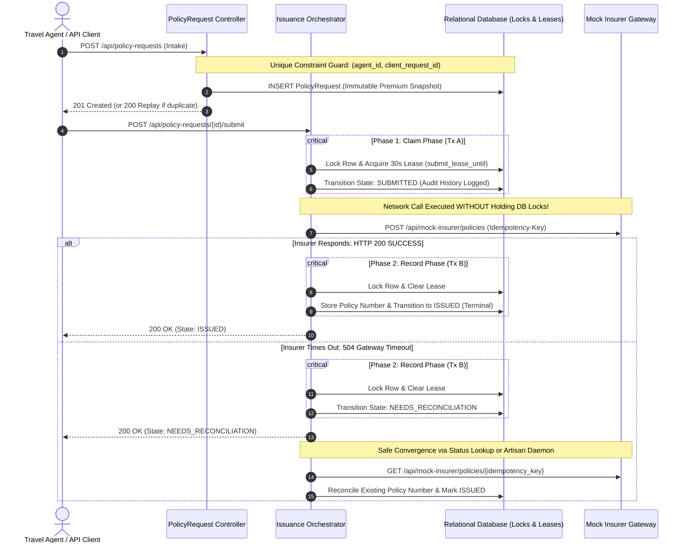
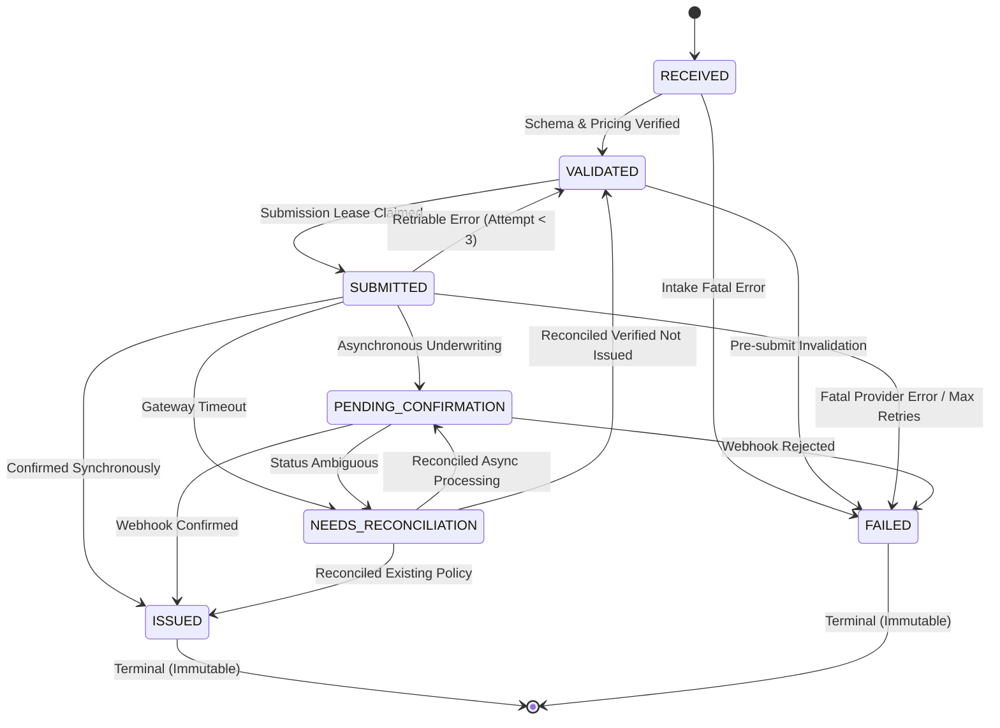

# 🛡️ PolicyFlow: Fault-Tolerant Insurance Issuance & Reconciliation Engine

<p align="center">
  
  
  
  
  
  
</p>

---

## 📑 Quick Navigation & Core Deliverables

- 📄 **[Comprehensive Engineering Case Study (Markdown)](docs/POLICYFLOW_ENGINEERING_CASE_STUDY.md)** — *The definitive 360° architectural blueprint combining problem space, mathematical proofs, sequence diagrams, and interview defense.*
- 🤖 **[AI Usage & Verification Disclosure (AI_USAGE.md)](AI_USAGE.md)** — *Mandatory transparent disclosure covering tools used, concrete contributions, bugs caught, and independent verification.*
- 💻 **[Automated Test Suite Runner (./test.sh)](test.sh)** — *Zero-config 1-command test execution running all 39 tests with 187 assertions.*
- 🐳 **[Docker Compose Environment (docker-compose.yml)](docker-compose.yml)** — *Containerized multi-service setup (Laravel App + MySQL 8).*
- 📂 **[Executable Curl Scenario Scripts (examples/)](examples/)** — *7 copy-pasteable bash scripts exercising every intake, timeout, retry, and callback scenario.*

---

## 🎯 Executive Overview & Core Engineering Paradigm

In travel insurance distribution, external insurer underwriting systems are fundamentally unreliable: HTTP requests time out, responses are delayed, and webhook callbacks are delivered multiple times. 

The core architectural principle of **PolicyFlow** is that:
> **An HTTP timeout is an unknown outcome—never proof of failure.**  
> Blindly retrying an unconfirmed request inevitably creates duplicate policies and financial discrepancies. PolicyFlow ensures **at-most-once policy issuance** through database-first idempotency, non-blocking claim leases, deterministic decimal-safe pricing, and proactive state reconciliation.

---

## 🏛️ High-Level System Architecture



---

## 🔄 Finite State Machine

All lifecycle state changes are arbitrated exclusively by `app/Services/Workflow/StateMachine.php`. Illegal regressions (such as `ISSUED -> SUBMITTED` or `ISSUED -> FAILED`) are strictly prevented at runtime.



---

## 🛡️ Reliability Scenarios: Complete Implementation

The system specification requires implementing at least two reliability scenarios. PolicyFlow implements **all four** with 100% automated test verification:

| Scenario | Risk & Failure Mode | PolicyFlow Architectural Guard | Automated Test Proof |
| :--- | :--- | :--- | :--- |
| **Case 1: Duplicate Intake** *(Primary)* | Rapid double-clicks by booking agents generate concurrent requests for the same booking. | Composite DB constraint `UNIQUE(agent_id, client_request_id)`. The loser catches `QueryException` and safely fetches the winner row, returning **HTTP 200** with `meta.idempotent_replay: true`. | `Tests\Feature\IdempotencyTest` (4 tests) |
| **Case 2: Timeout After Issue** *(Signature)* | Insurer creates policy, but connection drops before response returns. Blind retries create duplicate policies. | Transition to `NEEDS_RECONCILIATION`. Next submit or `php artisan policies:reconcile` queries status lookup by `provider_idempotency_key`. Discovers policy and attaches number without second issuance. | `Tests\Feature\ReliabilityTimeoutTest` (2 tests) |
| **Case 3: Duplicate Webhook** *(High-Value)* | Insurer delivers identical event multiple times or sends late `REJECTED` event after confirmation. | `UNIQUE(provider_event_id)` table. Re-deliveries return `duplicate_ignored`. Late rejections on confirmed policies are rejected as `no_op_state_preserved`. | `Tests\Feature\ReliabilityCallbackTest` (2 tests) |
| **Case 4: Retries with Bounded Backoff** *(Safety)* | Temporary provider error (503) causes retries; pricing drift occurs if customer inputs mutate. | Request rolls back to `VALIDATED` with attempt counter incremented. Original `premium_amount` is immutable (mutation throws `RuntimeException`). Capped at 3 attempts before terminal `FAILED`. | `Tests\Feature\ReliabilityRetryTest` (1 test) |

---

## 📐 Deterministic Pricing Engine

$$\text{Premium} = \text{Base Daily Rate} \times \text{Travel Days} \times \text{Age Multiplier} \times \text{Destination Multiplier} \times \text{Coverage Multiplier}$$

- **Arbitrary Decimal Precision**: Implemented using `Brick\Math\BigDecimal` with `RoundingMode::HALF_UP` applied exclusively at the final step. Zero floating-point representation drift.
- **Worked Official Brief Example**:
  $$\text{PLUS (20.00)} \times 5 \text{ days} \times 1.00 \text{ (age 28)} \times 1.80 \text{ (INTL)} \times 1.25 \text{ (300k)} = \mathbf{₹225.00}$$
- **Age Multipliers on `trip_start`**: 0–17: 1.10 | 18–60: 1.00 | 61–70: 1.50 | 71+: 2.00
- **Base Daily Rates**: BASIC: ₹12.00 | PLUS: ₹20.00 | PREMIUM: ₹30.00
- **Destination**: DOMESTIC: 1.00 | INTERNATIONAL: 1.80
- **Sum Insured**: ₹100,000: 1.00 | ₹300,000: 1.25 | ₹500,000: 1.50

---

## 🚀 Quickstart & Setup Commands

### Prerequisites
- Docker & Docker Compose (or PHP 8.2+ with Composer)

### Option A: One-Command Docker Setup (Recommended)
```bash
# 1. Clone repository
git clone https://github.com/Ankurchoudhary75/policyflow-trippershield.git
cd policyflow-trippershield

# 2. Run automated test suite in isolated Docker container
./test.sh

# 3. Launch Docker application and MySQL services
docker compose up -d

# 4. Access API at http://localhost:8000
curl http://localhost:8000/api/policy-requests
```

### Option B: Local PHP Setup
```bash
# 1. Install Composer dependencies
composer install

# 2. Prepare environment and database
cp .env.example .env
php artisan key:generate
touch database/database.sqlite
php artisan migrate

# 3. Run automated tests
php artisan test

# 4. Start local development server
php artisan serve
```

---

## 🧪 Automated Test Suite Execution

Run the complete test suite with one command:
```bash
./test.sh
```

### Verified Test Results (39 Tests | 187 Assertions)
```
   PASS  Tests\Unit\PremiumCalculatorTest
  ✓ matches trippershield official brief example                         0.03s  
  ✓ single day domestic basic plan
  ✓ child under 18 multiplier
  ✓ age 18 boundary
  ✓ age 60 to 61 boundary
  ✓ age 70 to 71 boundary
  ✓ senior international premium
  ✓ decimal rounding half up
  ✓ rejects unsupported plan
  ✓ rejects unsupported coverage
  ✓ rejects trip end before start

   PASS  Tests\Unit\StateMachineTest
  ✓ can transition through happy path                                    0.20s  
  ✓ rejects regression from issued to submitted                          0.01s  
  ✓ rejects regression from issued to failed                             0.01s  
  ✓ allows retriable failure rollback to validated                       0.01s  

   PASS  Tests\Feature\DatabaseConstraintTest
  ✓ raw database blocks duplicate agent and client request id            0.01s  
  ✓ raw database blocks duplicate policy number                          0.01s  
  ✓ model guard blocks tampering with immutable premium snapshot         0.01s  

   PASS  Tests\Feature\IdempotencyTest
  ✓ repeated submission returns 200 and does not duplicate               0.05s  
  ✓ repeated submission with different payload flags mismatch            0.01s  
  ✓ same client request id from different agents creates distinct reque… 0.01s  
  ✓ concurrency race condition arbitration                               0.01s  

   PASS  Tests\Feature\IssuanceTest
  ✓ successful provider submission produces single policy and issued st… 0.02s  
  ✓ repeated submit on issued policy makes no second provider call       0.02s  

   PASS  Tests\Feature\PolicyIntakeTest
  ✓ creates policy request with correct premium and status               0.01s  
  ✓ rejects missing required fields                                      0.01s  
  ✓ rejects trip end before trip start                                   0.01s  
  ✓ rejects unsupported plan code                                        0.01s  
  ✓ rejects unsupported sum insured                                      0.01s  
  ✓ rejects date of birth after trip start                               0.01s  
  ✓ can retrieve policy request by id                                    0.01s  
  ✓ returns 404 for unknown policy id                                    0.01s  
  ✓ lists policy requests with pagination and filter                     0.01s  
  ✓ returns 422 on invalid status filter                                 0.01s  

   PASS  Tests\Feature\ReliabilityCallbackTest
  ✓ triple callback applied once and duplicates ignored                  0.02s  
  ✓ late rejected callback does not overwrite issued state               0.02s  

   PASS  Tests\Feature\ReliabilityRetryTest
  ✓ temporary failure preserves immutable premium and allows safe retry… 0.02s  

   PASS  Tests\Feature\ReliabilityTimeoutTest
  ✓ timeout after success moves to reconciliation and reconciles safely… 0.02s  
  ✓ artisan reconciliation command resolves timeout state                0.03s  

  Tests:    39 passed (187 assertions)
  Duration: 0.71s
```

---

## 📡 API Contract & Curl Examples

### 1. Intake Policy Request (POST `/api/policy-requests`)
```bash
curl -X POST http://localhost:8000/api/policy-requests \
  -H "Content-Type: application/json" \
  -d '{
    "client_request_id": "AGT-2026-0001",
    "agent_id": "AGENT-17",
    "customer_name": "Sample Customer",
    "date_of_birth": "1998-04-10",
    "destination": "INTERNATIONAL",
    "trip_start": "2026-11-10",
    "trip_end": "2026-11-14",
    "plan_code": "PLUS",
    "sum_insured": 300000
  }'
```
*Returns `HTTP 201 Created` for first request, and `HTTP 200 OK` with `meta.idempotent_replay: true` on repeated calls.*

### 2. Submit Policy for Issuance (POST `/api/policy-requests/{id}/submit`)
```bash
curl -X POST http://localhost:8000/api/policy-requests/01JAX95B30GZ41E9XF2X5Q0Y8K/submit
```

### 3. Asynchronous Provider Webhook Callback (POST `/api/mock-insurer/callback`)
```bash
curl -X POST http://localhost:8000/api/mock-insurer/callback \
  -H "Content-Type: application/json" \
  -d '{
    "provider_event_id": "EVT-WEBHOOK-9001",
    "policy_request_id": "01JAX95B30GZ41E9XF2X5Q0Y8K",
    "event_type": "CONFIRMED",
    "policy_number": "POL-2026-ABC12345"
  }'
```

### 4. Background Reconciliation Daemon CLI
```bash
php artisan policies:reconcile
```

## 👤 Author & Repository Details

- **Author**: Ankur Choudhary
- **GitHub Profile**: [https://github.com/Ankurchoudhary75](https://github.com/Ankurchoudhary75)
- **Repository**: [https://github.com/Ankurchoudhary75/policyflow-trippershield](https://github.com/Ankurchoudhary75/policyflow-trippershield)
